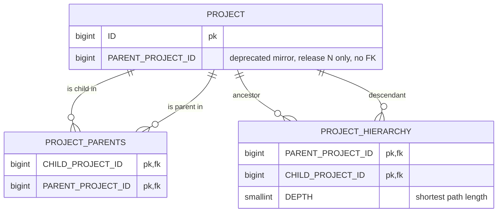
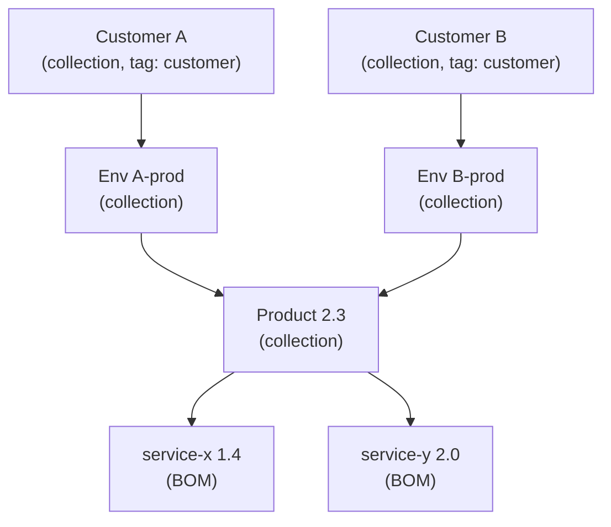

# Plan: Multiple parents per project

Status: draft plan, **revision 2** (2026-09-29). Based on the `multiple-parents` branch at `a1cc5ce`
(version `5.2.0-SNAPSHOT`).

Revision 2 merges the earlier decision memo on maintainer preferences. It also applies the amendments from
the Discussion #5845 coverage check. §19 has the change log.

Implementation instructions for a coding session are in [`MULTIPLE_PARENTS_HANDOFF.md`](MULTIPLE_PARENTS_HANDOFF.md).

Legend:
- **Verified**: read in the code, or on the upstream page.
- **Reported**: taken from GitHub pages by a research agent. Its fetcher may paraphrase slightly, so check
  the page before citing it in the ADR.
- **Inferred**: derived from reading, not executed.
- **Sketch**: proposed SQL or Java. It has not been compiled or tested.

---

## 0. Summary

Projects form a tree today:
- a scalar column `PROJECT.PARENT_PROJECT_ID`;
- a closure table `PROJECT_HIERARCHY`, which database triggers maintain (ADR 005).

Almost every read path uses the closure table: portfolio ACL, policy scoping, notification routing,
collection metrics, and the "without descendants" pickers. Most of these consumers already use `EXISTS`
or `DISTINCT` semantics, so they keep working on a DAG.

The maintainer has said that multiple parents are possible, but not trivial (§2). He named five
concerns, and each one has an answer below:
- notify-children;
- policy include-children;
- ACL leakage;
- metrics aggregation;
- cycle detection.

The work concentrates in seven places:

1. **Schema.** Add an edge table `PROJECT_PARENTS` and change the closure table to shortest-path depth.
   The triggers must be correct for a DAG.
2. **Integrity.** Cycles are prevented in the database, and concurrent writers are serialized.
   Cascading delete changes: a child is deleted only when it loses its *last* parent through deletion.
3. **Rolling-upgrade safety.** Expand in release N, and keep `PARENT_PROJECT_ID` as a trigger-synced
   mirror. Contract in release N+1.
4. **Opt-in and access control.** A feature flag that defaults to off. With PAC enabled, adding an
   *additional* parent is treated as an access grant.
5. **Queries.** About 10 SQL fragments read the scalar column. Collection metrics must not double count.
6. **API.** In v1, add `parents` and keep a deprecated `parent`. In v2, add link and unlink endpoints, a
   batched children operation, and an "affected ancestors" query. The last one answers "Which of my
   customers are exposed to this CVE?".
7. **ADR, modelling guidance, tests, docs.**

---

## 1. Current state (what the plan builds on)

| Area | Location | Notes |
|:--|:--|:--|
| Parent column and FK | `migration/.../V202605022031__init.sql:871`, `:1979` (index), `:2233-2234` (`PROJECT_PROJECT_FK ... ON DELETE CASCADE DEFERRABLE INITIALLY DEFERRED`) | The cascade is how descendants get deleted today. |
| Closure table | `init.sql:1094-1098`, PK `(PARENT_PROJECT_ID, CHILD_PROJECT_ID)` at `:1699-1700`, FKs `:2224-2228` | No index on `CHILD_PROJECT_ID` (verified). |
| Trigger functions | `init.sql:221-265`, triggers `:2065-2069` | The insert and update triggers read `NEW."PARENT_PROJECT_ID"` as a scalar. |
| JDO model | `apiserver/.../model/Project.java:277-288` (`parent`, and `children mappedBy parent`); fetch groups `ALL` (`:95-96`) and `PARENT` (`:134-136`) | v1 serializes this model directly. `parent` is `@JsonIncludeProperties({"name","version","uuid"})`. |
| Create and update rules | `persistence/ProjectQueryManager.java:206-210`, `:252-279`, `:295-297`; `isChildOf` at `:582-597`; `hasActiveChild` at `:599-617` | Self-parent, inactive-parent, cycle and "active children" checks. |
| JDBI list and delete | `persistence/jdbi/ProjectDao.java`: collection metrics `:85-178`, `hasChildren` `:261-266` and `:508-513`, `onlyRoot` `:360-363` and `:671-673`, parent filter `:364-373` and `:646-655`, parent join `:550-562`, `deleteProjects` `:721-765`, retention deletes `:767-811`, clone `:854-889` | |
| Collection metrics | `persistence/jdbi/MetricsDao.java:289-437`, `:444-544` | A recursive CTE over `DEPTH = 1`, with `UNION ALL` and `SUM`. |
| Clone | `migration/.../R__clone_project.sql:62,81` | Copies `PARENT_PROJECT_ID`. |
| ACL | `ApiRequestStatementCustomizer.java:70-91`, `QueryManager.java:1021-1065`, `support/datanucleus-plugin/.../ProjectIsAccessibleByMethod.java` | `EXISTS` over the closure table. Works on a DAG. |
| Policies and notifications | `CelPolicyDao.java:388-396`, `NotificationRouter.java:301-320` and `:402-421`, `ScheduledNotificationDao.java:98-128` | `UNION`, `EXISTS` or `DISTINCT` over the closure table. Works on a DAG. |
| Affected projects | `resources/v1/VulnerabilityResource.java:298` (`/v1/vulnerability/source/{source}/vuln/{vuln}/projects`) | Returns only projects that contain the affected component. There is no ancestor roll-up. |
| v1 API | `ProjectResource` (create `:558-734`, update `:739-866`, patch `:872-1041`, delete `:1111-1171`, children `:1269-1457`, `withoutDescendantsOf` `:1460-1523`); `BomResource` (`parentUUID`/`parentName`/`parentVersion`); `vo/ListProjectsResponseItem.Parent`; `AccessControlResource:117-130` | |
| v2 API | `api/src/main/openapi/**`: `/projects/{uuid}/clone`, `/projects/{uuid}/components`, `/vulns/{source}/{vuln_id}/kev-assertions` | There is **no** parent concept yet. The v2 clone copies the parent implicitly. |
| Config toggles | `model/ConfigPropertyConstants.java:255` (`ACCESS_MANAGEMENT_ACL_ENABLED`, a DB-stored boolean) | The template for the new feature flag. |
| Not affected | proto (the policy and notification `Project` messages have no parent), Pebble templates, the CEL library (no hierarchy functions), e2e, dex | |

---

## 2. Maintainer context (upstream evidence)

Sources: issues, pull requests, discussions and docs of `DependencyTrack/dependency-track` and
`DependencyTrack/docs`, read on 2026-09-29. Issue comment threads could not be loaded. Pull request,
discussion and docs pages could.

| Topic | Evidence | Kind |
|:--|:--|:--|
| Multiple parents | nscuro in [Discussion #5845](https://github.com/DependencyTrack/dependency-track/discussions/5845) (2026-04-02): multiple parents have *"a lot of implications that are not trivial"*. He lists notify-children, policy include-children and the ACL risk (*"teams gaining access to projects they shouldn't have access to"*), and says a DAG *"impacts metrics aggregation, requires cycle detection"*. He values *"efficient query patterns using closure tables"*, and ends: *"very much open to reworking the current model, but it will very likely necessitate breaking changes"*. He links this to decoupling project from version (#6188, labelled `breaking change`, milestone 6.x). The community closed the discussion by agreeing to keep the tree. | Verified |
| ACL inheritance | The docs say access is inherited by *"every descendant, current and future"*. #6871 complained about that inheritance and was closed as **not an issue**. In #2545, nscuro required an ACL check on the parent. | Verified (#6871); reported (docs, #2545) |
| Delete | Cascading delete of descendants is intended. #6975 and #6976, which nscuro merged, log each cascaded descendant under its "closest requested ancestor". | Reported |
| v1 compatibility | ADR 036: *"the v1 API contract must not break"*, and new behaviour must be opt-in. ADR 007: new endpoints go to v2 only. In #7312, nscuro calls it intentional that POST without `parent` removes the parent. Round-trip breakage happened in #2470 (`parentUuid`) and #6280 (`hasChildren`). | Verified (ADR 036, ADR 007, #7312); reported (#2470, #6280) |
| Rolling upgrades | The docs' `upgrading-instances.md`: *"Old and new instances run side by side against the migrated schema"*. #6979: *"The corresponding DB column stays around to enable smooth rolling upgrades … We'll drop the column in 5.2"*. It was dropped in `V202609181327`. | Verified |
| Inactive rules | #2010, approved by nscuro, introduced the three rules. The docs repeat them. No rationale was given. | Reported |
| Collections | Collections aggregate direct children only, for performance (#3258). nscuro is wary of changes that *"drastically change metric values on existing projects"*. v5 computes collection metrics at read time (#7311). | Reported (#3258); verified (#7311) |
| Limits, BOM parents | No maintainer statement. #2545 added a single parent on `autoCreate`. | Reported |

**Consequence for the approach:**
- Build the feature additive and off by default.
- Answer each of nscuro's concerns explicitly in the ADR.
- Take the ADR to the maintainers before any implementation PR (D0).

---

## 3. Decisions

| # | Question | Decision | Basis / rejected alternatives |
|:--|:--|:--|:--|
| D0 | Target of the work | **Aim for upstream, and build so that fork-only use also works.** Post the ADR draft as a reply in #5845 or in a new discussion first. A person must file it (see `AGENTS.md`, "GitHub Issues and PRs"). | A fork-only feature means an ongoing merge cost on hot files: `ProjectDao`, the triggers, `ProjectResource`. |
| D1 | Storage of the relation | **Edge table `PROJECT_PARENTS(CHILD_PROJECT_ID, PARENT_PROJECT_ID)`**, with PK `(CHILD, PARENT)`, FKs `ON DELETE CASCADE`, and `CHECK (CHILD <> PARENT)`. | A `bigint[]` column has no FKs, and its triggers would be awkward. |
| D2 | Closure table semantics | **Keep `PROJECT_HIERARCHY` and its PK. `DEPTH` becomes the shortest path length.** `DEPTH = 1` still means exactly "direct edge", so the existing queries stay correct. | One row per path explodes on DAGs. Path counts lose the minimum depth on delete. Recursive CTEs would reverse ADR 005. |
| D3 | Delete semantics | **Orphan cascade**: a descendant is deleted only when *all* its parents are deleted. Unlinking never deletes. This is identical to today for trees, and keeps the #6976 logging model. | "Never cascade" changes behaviour. "Cascade all" deletes children still owned elsewhere, which means data loss and an ACL risk. |
| D4 | ACL inheritance | **Union**: a project is accessible through *any* ancestor. This is the documented "every descendant" rule, and it is what the existing `EXISTS` queries already compute. | Intersection makes no sense given the docs, and would need every ACL fragment rewritten. |
| D5 | Who may link or unlink | Linking needs `PORTFOLIO_MANAGEMENT`/`_UPDATE`, access to the child, and access to each new parent. **With PAC enabled, if the child ends up with more than one parent, the caller also needs `ACCESS_MANAGEMENT` or `PORTFOLIO_ACCESS_CONTROL_BYPASS`.** Unlinking needs access to the child and to the removed parent. Replacing a parent set never removes parents the caller cannot see. | This answers nscuro's ACL concern. Widening visibility becomes an explicit, admin-level act. A first parent, or a move, keeps today's requirements. |
| D6 | Deactivation rule | **Keep it strict**: any active descendant blocks deactivation. All three #2010 rules apply per parent. | Changing documented behaviour needs a reason, and nobody has asked for it. |
| D7 | v1 `parent` field | Keep it, **deprecated**: it is the first *accessible* parent, ordered by `name, version, uuid`. Add `parents`. Keep the #7312 semantics exactly. A GET-then-POST round trip must never drop parents (§9.2). | Omitting `parent` for multi-parent projects would let old clients remove all parents. |
| D8 | Removing `PARENT_PROJECT_ID` | **Expand, then contract.** Release N keeps the column as a deprecated mirror, synced in both directions by triggers, and drops `PROJECT_PROJECT_FK`. Release N+1 drops the column (§7). | Follows the #6979 precedent and the rolling-upgrade docs. *Revision 1 dropped it in the same release. That was reversed.* |
| D9 | Limits | No depth limit, as today. A fixed cap of **100 direct parents per project**, enforced by bean validation. Batched operations are capped at **1000 items** per request, the same as batchDelete. | No config property; keeps it simple. |
| D10 | BOM upload | **Unchanged**: one parent on `autoCreate`, with the existing ACL check. Links are added through v2 (§10). | #6773 and #5586 are about name uniqueness, not about multiple parents. |
| D11 | JDO vs. JDBI | **Hybrid.** `Project.parents` and `children` become a JDO M:N collection over `PROJECT_PARENTS`, so v1 DTOs and about 67 test call sites keep working. All new code uses JDBI. The triggers enforce consistency whichever layer writes. | JDBI-only would change the shape of `children` in `GET /v1/project/{uuid}`, and cause more test churn. |
| D12 | Opt-in | **Feature flag `PROJECT_MULTIPLE_PARENTS_ENABLED`**: a `ConfigPropertyConstants` entry, group `general`, name `project.multiple.parents.enabled`, default `false`, `READ_WRITE`, modelled on `ACCESS_MANAGEMENT_ACL_ENABLED`. While it is off, any operation that would leave a project with more than one parent is rejected. The schema and triggers are DAG-capable either way. Turning it off later keeps existing links. Only new "additional parent" links are rejected. | This follows the ADR 036 opt-in pattern. For deployments that don't opt in, nothing changes. |
| D13 | Round-trip safety | Every field that GET returns (`parents`, `parent`, `hasChildren`) must be accepted when sent back on PUT, POST or PATCH. A dedicated test covers this. | This is the lesson from #2470 and #6280. |
| D14 | Collections in a DAG | Deduplicate leaves per collection root. A shared child counts **once per collection** it belongs to. For existing trees, the values are unchanged. | This answers "metrics aggregation" and the #3258 concern about changing metric values. |

---

## 4. Target data model



The database enforces these invariants:

1. `PROJECT_PARENTS` is acyclic. A `CHECK` blocks self-edges, and a trigger blocks longer cycles.
2. `PROJECT_HIERARCHY` contains `(a, d, k)` exactly when `d` is reachable from `a`, where `k` is the
   shortest distance. It also contains `(p, p, 0)` for every project.
3. Every project that is still a descendant of a deleted project has at least one remaining parent.
4. Release N only: `PROJECT.PARENT_PROJECT_ID` is either `NULL` or the first parent in `name, version, uuid`
   order.

---

## 5. Closure maintenance algorithm

### 5.1 One refresh routine for insert and delete

Let `C` be the children whose incoming edges changed. Let `D = descendants*(C)`, including `C`, read from the
closure table. Two conditions hold:
- the graph is acyclic;
- the changed edges enter `D` from outside.

The cycle check guarantees both on insert, and acyclicity guarantees them on delete. Then:

- Rows `(x, d)` with `x, d ∈ D` are unaffected. A path inside `D` can't use an edge that enters `D`.
- Rows `(q, y)` with `y ∉ D` are unaffected.
- Only rows `(a, d)` with `d ∈ D` and `a ∉ D` can change. Every such path enters `D` exactly once, through an
  edge `(q, x)` with `q ∉ D` and `x ∈ D`. So
  `depth(a, d) = min over entry edges (q, x) of depth(a, q) + 1 + depth(x, d)`, and both terms are
  unaffected rows.

```sql
-- Sketch (untested)
CREATE FUNCTION project_hierarchy_refresh(affected_child_ids BIGINT[]) RETURNS VOID
  LANGUAGE plpgsql AS $$
DECLARE
  v_descendants BIGINT[];
BEGIN
  SELECT ARRAY_AGG(DISTINCT "CHILD_PROJECT_ID")
    INTO v_descendants
    FROM "PROJECT_HIERARCHY"
   WHERE "PARENT_PROJECT_ID" = ANY(affected_child_ids);

  DELETE FROM "PROJECT_HIERARCHY"
   WHERE "CHILD_PROJECT_ID" = ANY(v_descendants)
     AND NOT ("PARENT_PROJECT_ID" = ANY(v_descendants));

  INSERT INTO "PROJECT_HIERARCHY" ("PARENT_PROJECT_ID", "CHILD_PROJECT_ID", "DEPTH")
  SELECT anc."PARENT_PROJECT_ID"
       , dsc."CHILD_PROJECT_ID"
       , MIN(anc."DEPTH" + 1 + dsc."DEPTH")
    FROM "PROJECT_PARENTS" AS e
   INNER JOIN "PROJECT_HIERARCHY" AS anc
      ON anc."CHILD_PROJECT_ID" = e."PARENT_PROJECT_ID"
   INNER JOIN "PROJECT" AS anc_project          -- robustness against trigger ordering during deletes
      ON anc_project."ID" = anc."PARENT_PROJECT_ID"
   INNER JOIN "PROJECT_HIERARCHY" AS dsc
      ON dsc."PARENT_PROJECT_ID" = e."CHILD_PROJECT_ID"
   WHERE e."CHILD_PROJECT_ID" = ANY(v_descendants)
     AND NOT (e."PARENT_PROJECT_ID" = ANY(v_descendants))
   GROUP BY anc."PARENT_PROJECT_ID", dsc."CHILD_PROJECT_ID";
END;
$$;
```

Cost is roughly `|D| × |ancestors outside D|` per change. Parent edits are rare. Retention deletes are
handled once per statement.

### 5.2 Triggers

| Table / event | Level | Action |
|:--|:--|:--|
| `PROJECT` AFTER INSERT | row | Insert the self-row `(id, id, 0)` only. Its trigger name must sort **before** the mirror trigger below, because triggers fire in name order and the refresh needs the self-row. |
| `PROJECT` AFTER UPDATE OF `PARENT_PROJECT_ID` | n/a | The old hierarchy trigger is **dropped**. |
| `PROJECT` AFTER DELETE | statement | Unchanged: deletes closure rows that reference deleted IDs. |
| `PROJECT_PARENTS` AFTER INSERT | row | 1. Take the hierarchy lock (§5.3). 2. **Cycle check**: if a closure row `(NEW.child → NEW.parent)` exists, `RAISE ... USING ERRCODE = 'check_violation', CONSTRAINT = 'PROJECT_PARENTS_ACYCLIC'`. 3. `project_hierarchy_refresh(ARRAY[NEW.child])`. 4. *Release N only:* update the mirror column (§7.2). |
| `PROJECT_PARENTS` AFTER DELETE | statement (`REFERENCING OLD TABLE`) | 1. Take the hierarchy lock. 2. **Orphan cascade**: delete the children in `old_table` that still exist, have no remaining edge, and lost an edge whose parent **no longer exists**. The last condition distinguishes a deletion from an unlink. It recurses through the FK cascade and this trigger. 3. Refresh the surviving children. 4. *Release N only:* update the mirror column. |
| `PROJECT` AFTER INSERT OR UPDATE OF `PARENT_PROJECT_ID` | row | *Release N only:* mirror column writes from old instances into edges (§7.2). |

The insert trigger is row-level on purpose. Each row's trigger sees the earlier rows' effects, so a multi-row
insert that closes a cycle within one statement is still caught.

**Trigger ordering during `DELETE FROM "PROJECT"`** (inferred; must be tested). The RI cascade into
`PROJECT_PARENTS` fires before the statement-level `PROJECT` delete trigger. So the refresh joins `PROJECT`
to ignore ancestors that are already deleted.

### 5.3 Concurrency

**Serialize all hierarchy writes** with `pg_advisory_xact_lock(<constant key>)` in both edge trigger
functions. The key must not collide with other advisory-lock users such as Flyway or db-scheduler. Under
READ COMMITTED, each plpgsql statement after the lock takes a fresh snapshot.

- **Deadlock risk** (inferred): a transaction that holds `PROJECT` row locks and then waits for the advisory
  lock can deadlock. Mitigation: application code that edits parents takes the lock *first*, via
  `ProjectDao.lockHierarchy()`.
- Inserting a plain project without parents, and updating non-hierarchy columns, never takes the lock.

### 5.4 Error mapping

`PROJECT_PARENTS_ACYCLIC` and `PROJECT_PARENTS_NOT_SELF_check` map from `PSQLException` as follows:
- v1: 409, the current behaviour.
- v2: 409 ProblemDetails.

Java pre-validates for friendly messages. The trigger is the backstop for races.

---

## 6. Flyway migrations

Follow `docs/DATABASE_MIGRATIONS.md`:
- create files with `make new-migration NAME="..."`;
- versioned files are immutable;
- `.sql.conf` with `executeInTransaction=false` is only for `CONCURRENTLY`;
- `-- squawk-ignore <rule>` only with precedent.

### Release N (expand)

**M1 `V<ts>__add_project_parents.sql`** (transactional)

1. `CREATE TABLE "PROJECT_PARENTS"` with the PK, the `CHECK`, and both FKs as
   `ON DELETE CASCADE DEFERRABLE INITIALLY DEFERRED`. Add `CREATE INDEX "PROJECT_PARENTS_PARENT_PROJECT_ID_IDX"`
   with `-- squawk-ignore require-concurrent-index-creation`, since this is a new table. Precedent:
   `V202608201827__add_project_last_analysis.sql:11`.
2. **Backfill**, before the edge triggers exist:
   `INSERT INTO "PROJECT_PARENTS" SELECT "ID", "PARENT_PROJECT_ID" FROM "PROJECT" WHERE "PARENT_PROJECT_ID" IS NOT NULL;`
3. Drop `trigger_project_hierarchy_maintenance_on_project_update` and its function. Replace the insert
   function with the self-row-only version.
4. **Rebuild `PROJECT_HIERARCHY`**: `DELETE`, then a recursive walk over `PROJECT_PARENTS` with `MIN(depth)`.
   The closure is then derived from the edge table by construction, independent of how it was maintained
   before.
5. Create `project_hierarchy_refresh`, the edge trigger functions and triggers, and the release-N mirror
   triggers (§7.2).
6. `ALTER TABLE "PROJECT" DROP CONSTRAINT "PROJECT_PROJECT_FK";`
   - An old instance that deletes a parent must not delete the children through the FK, bypassing the orphan
     cascade.
   - `SET NULL` is not an option either. Its RI update would fire the mirror trigger, and that would wipe the
     child's other edges.
   - The mirror column is kept consistent by the edge triggers in the same transaction, so it never dangles.

**M3 `V<ts+1>__add_project_hierarchy_child_idx.sql` plus `.sql.conf`**
- `CREATE INDEX CONCURRENTLY IF NOT EXISTS "PROJECT_HIERARCHY_CHILD_PROJECT_ID_IDX" ON "PROJECT_HIERARCHY" ("CHILD_PROJECT_ID")`.
- The refresh deletes by child. Confirm the benefit with `EXPLAIN`.

**`R__clone_project.sql`**
- Stop copying `"PARENT_PROJECT_ID"` (`:62`, `:81`). Copy the edges instead:
  `INSERT INTO "PROJECT_PARENTS" SELECT target_project.id, "PARENT_PROJECT_ID" FROM "PROJECT_PARENTS" WHERE "CHILD_PROJECT_ID" = source_project.id;`
- The edge trigger sets the mirror column.
- Old instances call the same, replaced database function, so their clones stay correct.

### Release N+1 (contract)

**M2 `V<ts>__drop_project_parent_project_id.sql`**
- Drop the mirror triggers and functions.
- `DROP INDEX "PROJECT_PARENT_PROJECT_ID_IDX"`.
- `-- squawk-ignore ban-drop-column`, then `ALTER TABLE "PROJECT" DROP COLUMN "PARENT_PROJECT_ID"`.
  Precedent: `V202609181327__drop_affectedversionattribution_last_seen_column.sql`.
- In the same PR, remove the mirror step from the edge trigger functions (`CREATE OR REPLACE FUNCTION`).

### Tests and tooling

- **Migration test**: follow `AddPackageMetadataResolutionMigrationTest`. Seed a multi-level tree at the
  previous version. Then migrate, and assert the edges, the mirror, and that the rebuilt closure matches a
  recursive-CTE ground truth.
  `MigrationTest` already covers idempotency.
- **v4 migrator: no change.** It is pinned to Flyway head `202605111028` (`Preflight.java:47`). M1 backfills
  when the apiserver starts. If the pin ever moves past M1, add a `PROJECT_PARENTS` `TableMigration`, and
  `DISABLE/ENABLE TRIGGER USER` for it in `LoadPhase`.
- **Local dev gotcha**: `PostgresTestContainer` skips migrations for reused containers. Remove stale containers.
- Run `make lint-migrations AGENT=1`.

---

## 7. Rolling upgrade (release N ↔ N-1 coexistence)

### 7.1 What old instances do during the roll-out

- They read `PROJECT.PARENT_PROJECT_ID` for `parent`, `hasChildren`, `onlyRoot` and the children lists. They
  see a tree-shaped projection through the mirror.
- They write `PARENT_PROJECT_ID` on create, update and patch.
- They delete projects with a plain `DELETE`. The orphan cascade now comes from the edge FK plus the trigger.
  The dropped `PROJECT_PROJECT_FK` no longer applies.

### 7.2 Mirror triggers (release N only)

```sql
-- Sketch (untested): old-instance writes of the column become edges.
CREATE FUNCTION project_parent_column_to_edges() RETURNS trigger LANGUAGE plpgsql AS $$
BEGIN
  IF current_setting('dtrack.project_parent_sync', TRUE) = 'on' THEN
    RETURN NULL; -- echo of an edge-trigger write
  END IF;
  PERFORM set_config('dtrack.project_parent_sync', 'on', TRUE);
  DELETE FROM "PROJECT_PARENTS"
   WHERE "CHILD_PROJECT_ID" = NEW."ID"
     AND "PARENT_PROJECT_ID" IS DISTINCT FROM NEW."PARENT_PROJECT_ID";
  IF NEW."PARENT_PROJECT_ID" IS NOT NULL THEN
    INSERT INTO "PROJECT_PARENTS" ("CHILD_PROJECT_ID", "PARENT_PROJECT_ID")
    VALUES (NEW."ID", NEW."PARENT_PROJECT_ID")
    ON CONFLICT DO NOTHING;
  END IF;
  PERFORM set_config('dtrack.project_parent_sync', 'off', TRUE);
  RETURN NULL;
END;
$$;
-- AFTER INSERT OR UPDATE OF "PARENT_PROJECT_ID" ... FOR EACH ROW
--   WHEN (NEW."PARENT_PROJECT_ID" IS DISTINCT FROM OLD."PARENT_PROJECT_ID")  -- update variant
```

Edges to column: at the end of each edge trigger, **unless** `dtrack.project_parent_sync = 'on'`, set the flag
and run
`UPDATE "PROJECT" SET "PARENT_PROJECT_ID" = (first parent by name, version, uuid)` for the affected children.
Then reset the flag.

- **Old instance changes a parent.** The edge set becomes `{new}`. That is the legacy "move" semantics.
- **Old instance round-trips a project without changing the parent.** The column is not dirty, so the
  trigger does not fire and the parents are preserved.

### 7.3 Operational rule

The upgrade guide for release N says:
- The roll-out follows `upgrading-instances.md`.
- Enable `project.multiple.parents.enabled` only **after** every instance runs release N. Old instances can
  only show one mirrored parent.
- Because the flag defaults to off (D12), no project has more than one parent during a roll-out unless an
  administrator enabled it early.

---

## 8. Persistence layer (apiserver)

### 8.1 `Project` JDO model

```java
// Sketch
@Persistent(table = "PROJECT_PARENTS")
@Join(column = "CHILD_PROJECT_ID", primaryKey = "PROJECT_PARENTS_PK",
      foreignKey = "PROJECT_PARENTS_CHILD_PROJECT_FK", deleteAction = ForeignKeyAction.CASCADE)
@Element(column = "PARENT_PROJECT_ID",
      foreignKey = "PROJECT_PARENTS_PARENT_PROJECT_FK", deleteAction = ForeignKeyAction.CASCADE)
@JsonIncludeProperties({"name", "version", "uuid"})
private Set<Project> parents;

@Persistent(mappedBy = "parents")
private Collection<Project> children;
```

- Remove the JDO `parent` field mapping from `PARENT_PROJECT_ID`. The column stays in release N, but only the
  triggers write it.
- Keep `getParent()` as a derived getter for JSON, marked `@Deprecated(forRemoval = true, since = "5.x")`
  (§9.1). The precedent is `AffectedVersionAttribution`.
- Fetch group `ALL`: replace `parent` with `parents`. Rename fetch group `PARENT` to `PARENTS`; its only user
  is PATCH at `ProjectResource:948`.
- Templates: `Project.tags` (`:300-307`), and the bidirectional pair `User.teams`/`Team.users`.
- Metadata is annotation-only and Flyway owns the DDL, so the names must match the migration.

### 8.2 `ProjectQueryManager` / `QueryManager`

- **Create:** add `Collection<Project> parents` overloads of `createProject`. Keep the single-parent
  overloads as wrappers, for BOM upload and tests.
- **Update (`updateProject`):**
  - Diff the current and requested sets. Add and remove only what changed.
  - Validate each added parent: not self, exists, accessible, active, not a descendant.
    - The descendant check is **one batched query**: `PROJECT_HIERARCHY` with `PARENT = :self` and
      `CHILD = ANY(:candidates)`.
  - Apply D5 (the extra permission for more than one parent, and preserving inaccessible parents), D9 (the
    cap) and D12 (the flag).
  - Take the hierarchy lock first.
  - Remove the redundant second `setParent` (`:276`).
- **Deactivation:** `hasActiveChild` is unchanged (D6). The inactive-parent check at `:206-210` loops over all
  parents.

### 8.3 `ProjectDao` (JDBI)

| Fragment | Change |
|:--|:--|
| `hasChildren` (`:261-266`, `:508-513`) | `EXISTS (SELECT 1 FROM "PROJECT_PARENTS" WHERE "PARENT_PROJECT_ID" = "PROJECT"."ID")` |
| `onlyRoot` / `onlyRootFilter` (`:360-363`, `:671-673`) | `NOT EXISTS (SELECT 1 FROM "PROJECT_PARENTS" WHERE "CHILD_PROJECT_ID" = "PROJECT"."ID")` |
| `parentUuidFilter` (`:364-373`, `:646-655`) | `EXISTS` over `PROJECT_PARENTS` joined to the parent's UUID. |
| Parent join (`:550-562`), and `ListProjectsRow.parentUuid/Name/Version` (`:480-483`) | Use a correlated `"parentsJson"` `JSONB_AGG` subquery ordered by `name, version, uuid` and **ACL-filtered on the parent alias**. This also fixes the leak in §16 item 1. `@DefineApiProjectAclCondition` supports a custom `name` but is not `@Repeatable`, so make it repeatable, or define `apiParentProjectAclCondition` in the dynamic builder. Don't `JOIN` edges into the page query. |
| `COLLECTION_METRICS_SUBQUERY` (`:85-178`) | Replace `UNION ALL … CYCLE` with `UNION`. Sum over **distinct** leaf `project_id` per root (D14). |
| `deleteProjects` (`:721-765`) | Reworked, see below. |
| Retention deletes | The SQL is unchanged. The orphan-cascade trigger reproduces today's behaviour. |
| `excludeDescendantsOfUuid` | Unchanged. |
| New methods | `getParents(childIds)`, `getChildren(parentId, page)`, `addParents(childId, parentIds)`, `removeParents(childId, parentIds)`, `applyChildrenChanges(parentId, add, remove)` (§10), `lockHierarchy()`, `findDescendantConflicts(childId, candidateIds)`, `countParentsAfter(childIds, …)` (for D5 and D9). |

**`deleteProjects` rework.** In one transaction:
1. Lock the accessible requested projects.
2. Read the candidate descendants with their closest requested ancestor. The shortest-path `DEPTH` still
   defines "closest".
3. Delete.
4. Return the candidates that no longer exist.

Make the resource calls (`ProjectResource:1122`, `:1143`) transactional, and update `logDeletedProjects`.

### 8.4 `MetricsDao`

- `getMostRecentCollectionProjectMetrics(Collection<Long>)` (`:444-544`): apply the same `UNION` and
  distinct-leaf change. The comment at `ProjectDao:83-84` says to keep the two in sync.
- `getCollectionProjectMetricsSince` (`:289-437`): switch to `UNION`. It already dedupes per day.

### 8.5 Affected-ancestors query (new, `VulnerabilityDao`)

```sql
-- Sketch: ancestors (depth >= 1) of projects affected by a vulnerability.
SELECT anc."UUID", anc."NAME", anc."VERSION", anc."COLLECTION_LOGIC" IS NOT NULL AS is_collection
     , COUNT(DISTINCT affected.project_id) AS affected_descendant_count
  FROM (<same "affected project" predicate as VulnerabilityDao.getAffectedProjects>) AS affected
 INNER JOIN "PROJECT_HIERARCHY" AS ph
    ON ph."CHILD_PROJECT_ID" = affected.project_id
   AND ph."DEPTH" > 0
 INNER JOIN "PROJECT" AS anc
    ON anc."ID" = ph."PARENT_PROJECT_ID"
 WHERE ${apiProjectAclCondition}        -- on anc; its descendants are visible by inheritance
   AND <optional filters: tag, is_collection, active>
 GROUP BY anc."ID"
```

- Reuse the v1 definition of "affected" so both endpoints agree.
- It is bounded by the closure index and supports keyset pagination on `anc."ID"`.

### 8.6 Unchanged, but must be re-verified by tests

- ACL fragments: `ApiRequestStatementCustomizer`, `QueryManager.getProjectAclSqlCondition`,
  `ProjectIsAccessibleByMethod`, the `PROJECT_ACCESS_USERS` triggers.
- `CelPolicyDao.getApplicablePolicies`
- `NotificationRouter.isChildOfAnyActiveParent`
- `ScheduledNotificationDao.getApplicableProjectIds`
- `isChildOf`
- `IS_LATEST`, which is per name.

---

## 9. REST API v1 (extend existing endpoints only)

### 9.1 Response shape

```json
{
  "parent":  { "uuid": "…", "name": "A", "version": "1.0" },
  "parents": [ { "uuid": "…", "name": "A", "version": "1.0" },
               { "uuid": "…", "name": "B" } ],
  "children": [ … unchanged … ]
}
```

- **Single-project responses** (`GET /v1/project/{uuid}`, `/latest/{name}`, `/lookup`, and the PUT, POST and
  PATCH responses):
  - `parents` is ordered by `name, version, uuid` and **ACL-filtered**, using one batched
    `getAccessibleProjectUuids` call.
  - `parent` is `parents[0]`, marked deprecated in Swagger.
- **List responses** (`ListProjectsResponseItem`, used by `GET /v1/project`, `/tag`, `/classifier`,
  `/{uuid}/children*`, `/withoutDescendantsOf`, `/v1/acl/team/{uuid}`): add `parents` and keep the deprecated
  `parent`.
- `ConciseProject` is unchanged. Only its SQL changes.

### 9.2 Request semantics (PUT create, POST update, PATCH)

| Request contains | PUT (create) | POST (full update) | PATCH |
|:--|:--|:--|:--|
| `parents: [...]` (non-null) | Set = listed | Set = listed ∪ (current parents the caller can't access) | Same as POST |
| `parents: []` | No parents | Remove all *accessible* parents | Same as POST |
| only legacy `parent: {uuid: X}` | `{X}` | If X ∈ current: **unchanged** (round-trip safe). Else: `{X}` ∪ inaccessible current parents | Same as POST |
| neither | No parents | Remove all accessible parents (#7312 semantics) | Unchanged |
| both | `parents` wins and `parent` is ignored. The round trip sends both consistently (D13). | same | same |

**Validation for each added parent** keeps today's codes and messages:

| Condition | Response |
|:--|:--|
| Missing `uuid` | 400 |
| Parent not found | 404 |
| Parent inaccessible | 403 |
| Parent inactive | 400 on create, 409 on update |
| Self or cycle | 409 |

**New validations:**

| Condition | Response |
|:--|:--|
| More than one parent while D12 is disabled | 400, "Multiple parents are not enabled" |
| More than 100 parents (D9) | 400 |
| Missing D5 permission | 403 |

### 9.3 Other v1 endpoints

- **DELETE and batchDelete:** the descriptions now document the orphan cascade. The logs list only projects
  that were actually deleted.
- **Clone:** copies all parents.
- **BOM upload:** unchanged (D10).
- **`onlyRoot`** means "no parents". Children endpoints list a shared child under each of its parents.

---

## 10. REST API v2 (new, spec-first)

The layout follows ADR 019:
- files under `api/src/main/openapi/resources/projects/` and `resources/vulns/`;
- paths registered in `openapi.yaml`;
- implementation in `resources/v2/ProjectsResource.java` and a vulns resource on JDBI;
- API models separate from persistence.

| Endpoint | Permission | Behaviour |
|:--|:--|:--|
| `GET /projects/{uuid}/parents` | `VIEW_PORTFOLIO` | Paginated list of accessible direct parents. |
| `GET /projects/{uuid}/children` | `VIEW_PORTFOLIO` | Paginated list of direct children. Needed alongside the batched operation below. |
| `PUT /projects/{uuid}/parents/{parent_uuid}` | `PORTFOLIO_MANAGEMENT` or `_UPDATE` (plus D5) | Idempotent link, returns 204. |
| `DELETE /projects/{uuid}/parents/{parent_uuid}` | same | Unlink, returns 204. Returns 404 if there is no such edge. Never deletes projects. |
| **`PATCH /projects/{uuid}/children`** | same (plus D5 per child) | Body `{"add": [uuid…], "remove": [uuid…]}`, at most 1000 entries in total. **Atomic**: one transaction under one hierarchy lock, where all changes apply or none do. It covers building a release from existing service versions, and a *deployment swap* (remove the old version and add the new one) with no window in which both or neither are linked. Errors are ProblemDetails listing the offending children: 404 (unknown child), 403 (inaccessible child, or missing D5 permission), 409 (cycle or inactive), 400 (cap, or flag disabled). |
| **`GET /vulns/{source}/{vuln_id}/affected-projects`** | `VIEW_PORTFOLIO` | Paginated list. `relation=direct` is the default, and returns the projects that contain an affected component, like v1. **`relation=ancestor`** returns the ancestor projects of affected projects, with `affected_descendant_count`. Filters: `tag`, `is_collection`, `active`. Answers "which customers are exposed", for example `relation=ancestor&tag=customer`. Portfolio ACL applies to the returned projects. |

**Errors for link, unlink and PATCH:**
- 404 if either project is missing.
- 403 if a project is inaccessible or the D5 permission is missing.
- 409 ProblemDetails for self, cycle or an inactive parent.
- 400 for the cap, or if the flag is disabled.
- All of them take the hierarchy lock first.

**Other points:**
- The v2 clone copies parents implicitly. No include flag is added.
- If PR #7348 (`GET /api/v2/projects`) lands first, also offer `has_affected_descendant=<source>/<id>` as a
  list filter backed by the same query (§8.5).
- The `openapi-breaking-changes` CI job sees only additive changes. Run `make lint-openapi AGENT=1`.

---

## 11. Business rules (consolidated)

1. A project may have 0 to 100 direct parents. More than one requires the D12 flag.
2. There are no self-parents and no cycles. The database enforces this, and Java pre-validates.
3. A newly added parent must exist, be accessible and be active.
4. A project with any active descendant cannot be deactivated.
5. **Access**: a project is accessible through itself or *any* ancestor. `INCLUDE_CHILDREN` policies and
   `NOTIFY_CHILDREN` rules also apply through any ancestor, and the existing queries dedupe.
6. **Linking** needs access to the child and to the new parent. With PAC enabled, ending up with more than
   one parent also needs `ACCESS_MANAGEMENT` or bypass (D5).
7. **Delete**: descendants that lose all their parents through deletion are deleted too. Unlinking never
   deletes.
8. **Collections**: a collection aggregates each qualifying leaf once. A leaf qualifies if *any* path
   qualifies. A shared child counts once per collection.
9. **Clone**: a clone gets the same parents as its source.
10. Replacing a parent set never removes parents the caller cannot see.

---

## 12. Modelling guidance (docs, and an ADR appendix)

This is the use case from Discussion #5845: **Customer → Environment → Product Version → Service Version**.



- **Containers:**
  - Customer, Environment and Product Version must all be **collection projects**
    (`AGGREGATE_DIRECT_CHILDREN`).
  - Aggregation recurses only through collection nodes. A *regular* project with children is a leaf, and
    its children are not summed.
- **Environments:**
  - Use `AGGREGATE_DIRECT_CHILDREN`, not `AGGREGATE_LATEST_VERSION_CHILDREN`. `IS_LATEST` is global per
    project name, while environments pin versions.
- **Tags:**
  - Tag the customer-level containers (for example `customer`). The affected-ancestors query can then filter
    on them.
- **Workflows:**
  - Building a release: `PATCH /projects/{product}/children` with `add` set to the existing service versions.
  - A deployment swap: `PATCH /projects/{env}/children` with `add` set to the new product and `remove` set to
    the old one.
  - CVE exposure: `GET /vulns/{source}/{id}/affected-projects?relation=ancestor&tag=customer`.
  - Notifications: a `NOTIFY_CHILDREN` rule per customer fires once per customer for a shared service.
    Payloads carry no hierarchy context. The rule tells you which customer it concerns.
- **Access:**
  - Grant customer teams access on the Customer node.
  - Shared service versions become visible to every customer team whose tree contains them. They are the same
    artifact.
  - With PAC enabled, linking a shared node under a second parent needs `ACCESS_MANAGEMENT` (D5).
- **Deletion gotcha:**
  - Deleting a container deletes descendants that are left without any parent.
  - Example: deleting Env A-prod deletes nothing here, because Product 2.3 is still under Env B-prod.
  - If Product 2.3 were only under Env A-prod, Product 2.3 would be deleted, along with every service that
    lives only under it.
  - Unlink first if descendants must survive.

---

## 13. Frontend (separate repo `DependencyTrack/frontend`)

- **Project details:** show parent chips and a multi-select, using the `withoutDescendantsOf` candidates.
  Send `parents`, or use v2. Hide the multi-select while the D12 flag is off.
- **Creation dialog:** a parent multi-select.
- **Tree view:** a shared child renders under each parent. Client-side counters must not double count.
- **Breadcrumbs:** show one path, plus a "multiple parents" indicator.
- **Vulnerability view:** an "affected customers / containers" tab using `relation=ancestor`.
- **Migration:** switch from reading `parent` to `parents` well before `parent` is removed.

---

## 14. ADR and documentation

**New ADR `docs/adr/043-multiple-project-parents.md`**, from `000-template.md`, following the
`docs/adr/README.md` style. *Accepted* is required before the implementation merges. Contents:

- **Context:**
  - the use cases from #5845, #4953, and the release-reuse case;
  - today's tree model and ADR 005.
- **Possible Solutions**, with pros and cons:
  1. **Tags**: no metric aggregation, and no inheritance of notifications, policies or ACL. Passarinho4
     calls tags a poor workaround.
  2. **External grouping layer**: this is where #5845 ended. It duplicates the data model, and cannot use
     portfolio ACL or collection metrics.
  3. **Wait for #6188 (6.x)**: correct long-term, but blocks the use case for a major release.
  4. **Array column**, or **path-per-row closure**: rejected (D1, D2).
  5. **Edge table plus shortest-path closure** (chosen).
- **Decision:**
  - D1 to D14.
  - A table mapping each of nscuro's concerns to its answer: notify-children, policies, ACL, metrics,
    cycles, and closure-table efficiency.
- **Why non-breaking in 5.x:** this answers nscuro's expectation of breaking changes.
  - v1 changes are additive, and `parent` is retained.
  - The flag defaults to off, so there is no semantic change without opt-in.
  - Delete semantics and aggregation values are identical for trees.
  - The column is removed through expand and contract.
- **Deferred to 6.x:**
  - removing v1 `parent`;
  - possibly making the flag default on, or removing it.
- **Forward compatibility with #6188:**
  - Today's edges link *versions*, that is `PROJECT` rows. In #6188's model they map 1:1 to
    `project_version → project_version` edges.
  - #6188 moves ACL to the `project` level. Whether version-level edges then carry ACL inheritance is a
    question for that ADR, and this ADR must name it.
  - Pure grouping nodes (Customer, Environment) might become versionless projects there.
- **Consequences:**
  - write overhead;
  - the global hierarchy lock;
  - the orphan-cascade deletion gotcha;
  - notification payloads without hierarchy context;
  - a transient mirror column.

**Other documentation:**
- **ADR 005:** add a `## Follow-up (yyyy-mm-dd)` section. The closure table remains; the maintenance and depth
  semantics change.
- **`docs/PORTFOLIO_ACCESS_CONTROL.md:36-40`:** change "tree" to "DAG", and describe union inheritance and D5.
- **Public docs:**
  - `concepts/projects.md`, `concepts/access-control.md`, the collection projects page, and the modelling
    guidance (§12);
  - the release N upgrade guide (§7.3) and the new configuration property.

---

## 15. Test plan

**Commands:**
- `make test-single MODULE=apiserver TEST=... AGENT=1`
- `make build AGENT=1`
- Before each PR: `make format-java AGENT=1`, `make lint-migrations AGENT=1` and `make lint-openapi AGENT=1`,
  or `make lint AGENT=1`.

**Closure maintenance** (`ProjectHierarchyMaintenanceTest`, extended):
- A diamond gives a single `(A, D, 2)` row.
- A second parent on a subtree root propagates to all descendants.
- Removing one of two parents keeps the other path. Removing a shortcut edge increases the depth.
- Removing both parents leaves only self-rows.
- Cycle rejection: direct, indirect, and within a single multi-row statement.
- The self-edge `CHECK`.
- **Property-based test**: random edge adds and removes, and project deletes. After each step, compare with a
  recursive-CTE ground truth.
- **Concurrency**: `A→B` and `B→A` in parallel. Exactly one succeeds.
- **Delete**:
  - A shared child survives.
  - A child is deleted when all its parents are deleted, in one statement or two.
  - Retention cascades orphans.
  - `deleteProjects` reports only real deletions.
- **Deep chain**: 50 levels, to check against `max_stack_depth`.

**Mirror and rolling upgrade (release N):**
- An old-style write of `PARENT_PROJECT_ID` (on insert, change, or set to null) produces the right edges.
- An edge write updates the mirror to the first parent.
- No trigger echo loop.
- A plain delete of a parent, with no `PROJECT_PROJECT_FK`, follows the orphan cascade.
- Clone sets the mirror.

**Migration:** `AddProjectParentsMigrationTest` covers the backfill, the closure rebuild (compared with a
recursive-CTE ground truth), and the mirror.

**Feature flag and permissions:**
- While the flag is off, a second parent is rejected in v1, v2 and the batched PATCH.
- Turning the flag off keeps existing links.
- With PAC on, adding a second parent without `ACCESS_MANAGEMENT` or bypass gives 403. With it, the call
  succeeds.
- A first parent, or a move, needs no extra permission.

**ACL** (per `PORTFOLIO_ACCESS_CONTROL.md`):
- Access through the second parent only.
- Inaccessible parents are hidden in `parents`, `parent` and list items.
- POST and PATCH preserve inaccessible parents.
- 403 for an inaccessible new parent.
- The bypass permission.
- Diamond cases in `ProjectIsAccessibleByMethodTest` and `ApiRequestStatementCustomizerTest`.

**v1 API** (`ProjectResourceTest`, `BomResourceTest`):
- The `parents` JSON shape, and the deprecated `parent`.
- Every row of the §9.2 matrix.
- Unchanged error codes and messages.
- **The D13 round trip**: GET a single-parent and a multi-parent project, POST it back unchanged, and assert
  that nothing changed and no "Unrecognized field" error occurs.
- `onlyRoot`, `hasChildren` and the children endpoints.
- Delete semantics.

**v2 API:**
- Link and unlink: happy paths, idempotency, 403, 404, 409, pagination.
- `PATCH children`: atomicity (one bad entry rejects everything), the swap case, the 1000-item cap, per-child
  D5.
- `affected-projects`:
  - `direct` agrees with v1;
  - `ancestor` returns only ancestors, with correct counts;
  - the tag filter works;
  - ACL applies to the returned ancestors.

**Collections** (`MetricsResourceTest`, `ProjectResourceTest`, `BadgeResourceTest`):
- A diamond through nested collections counts the leaf once in the list, current, since and badge paths.
- Mixed tag and latest filters.
- Values are unchanged for existing tree fixtures.

**Policies and notifications** (`CelPolicyEngineTest`, `NotificationRouterTest`,
`ProcessScheduledNotificationRuleActivityTest`):
- A rule or policy on the second parent applies.
- No duplicate notifications or violations.

**Clone:** v1 and v2 clones copy all parents.

**End-to-end scenario (#5845)**, a resource-level test in apiserver, optionally mirrored in `e2e`:
1. Build the §12 model, with Customers A and B sharing Product 2.3 through their environments.
2. Add a finding for a CVE in `service-x 1.4`.
3. Assert:
   - both customers' collection metrics count it **exactly once**;
   - `affected-projects?relation=ancestor&tag=customer` returns both customers;
   - a `NOTIFY_CHILDREN` rule per customer fires once each.
4. Swap Env A-prod to Product 2.4 with one `PATCH`.
5. Assert that Customer A is no longer affected, and Customer B still is.

**Test churn:**
- About 67 `project.setParent(...)` calls become `setParents(Set.of(...))` or `addParent(...)`.
- `ProjectTest.shouldCascadeDeleteOfParent` is updated to the orphan-cascade semantics.

---

## 16. Existing issues found during analysis

1. **List endpoints leak the name and version of inaccessible parents.** Verified at `ProjectDao.java:550-562`.
   - It is fixed by the ACL-filtered `parentsJson` subquery (§8.3).
   - It ships in phase 2 together with that rewrite.
2. **BOM auto-create with an inactive parent returns 500** (inferred). Minor, and optional.

Inconsistencies left alone:
- An inactive parent gives 400 on create but 409 on update.
- There are three different "parent not found" bodies.
- `/concise/{uuid}/children` returns 200 `[]` for an unknown parent.

---

## 17. Delivery phases

| Phase | Release | Content | User-visible? |
|:--|:--|:--|:--|
| 1 | n/a | ADR 043 plus the upstream discussion (D0). Taken to *Accepted*. | No |
| 2 | N | **Expand, with the flag off**: M1, M3, the mirror triggers, `R__clone_project`, the JDO `parents` mapping, the `ProjectDao` rewrites (including the §16 item 1 leak fix), the `deleteProjects` rework, the orphan cascade, the hierarchy lock, closure, mirror and migration tests. The API still enforces a single parent. | No |
| 3 | N | **Multiple parents behind the flag**: `PROJECT_MULTIPLE_PARENTS_ENABLED`, the D5 permission rule, the §9.2 matrix, `parents` in responses, the collection dedupe, and the ACL, policy, notification, collection and round-trip tests. | Opt-in |
| 4 | N | v2: parents and children endpoints, the batched `PATCH children`, `affected-projects` with `relation=ancestor`, and the end-to-end scenario. | Opt-in |
| 5 | N | Docs (§14), the upgrade guide (§7.3), modelling guidance (§12), and the frontend. | Yes |
| 6 | N+1 | **Contract**: M2 drops the mirror triggers and the column. | No |

---

## 18. Risks and open questions

- **Maintainer acceptance (D0):** the maintainer may prefer to wait for #6188 in 6.x. The flag and
  expand/contract approach keep 5.x non-breaking, but the ADR discussion decides this.
- **Global hierarchy lock:** it serializes parent edits, deletes that touch edges, and retention batches.
  Watch lock waits in large portfolios.
- **Trigger recursion depth:** covered by the deep-chain test.
- **Closure growth:** the row count is the sum of |ancestors| per project, bounded by D9.
- **Semantic surprises:** "access through any parent", "a shared child survives", and the deletion gotcha in
  §12. Document them all.
- **Mirror during the roll-out:** old instances see one parent. That is acceptable, because the flag should
  stay off until the roll-out completes (§7.3).
- **Flag location:** a DB config property (UI-toggleable) versus an application property. This plan follows
  `ACCESS_MANAGEMENT_ACL_ENABLED`. Confirm it in the ADR discussion.

---

## 19. Coverage of Discussion #5845 and change log

### 19.1 Coverage (after revision 2)

| # | Requirement or concern (source) | Status | Where |
|:--|:--|:--|:--|
| P1 | Multiple parents per project version (proposal) | ✅ | D1, §4 |
| P2 | Logical containers for customers and environments (proposal) | ✅ | Collection projects, §12 |
| P3 | Customer → Environment → Product → Service (proposal) | ✅ | §12 modelling guidance |
| P4 | One SBOM upload reflects risk for many customers (proposal) | ✅ | §9, §10 |
| P5 | Containers inherit the risk status correctly (proposal) | ✅ | D14, §8.3, §8.4 |
| P6 | "Which of my customers are exposed to this CVE?" (proposal) | ✅ | §8.5, §10 `affected-projects?relation=ancestor` |
| P7 | No change to the SBOM format (proposal) | ✅ | Relationship-only change |
| P8 | Alternatives: tags, external tooling (proposal, Passarinho4) | ✅ | §14 Possible Solutions |
| W1 | Release reuses unchanged service versions (Walnussbaer) | ✅ | Additional parent, §12 |
| W2 | Attaching many projects at once, and atomic swaps (implied) | ✅ | §10 `PATCH /projects/{uuid}/children` |
| N1 | Notify children (nscuro) | ✅ | §8.6, §11 rule 5, §15. Payload limitation documented in §12 and §14 |
| N2 | Policies including children (nscuro) | ✅ | §8.6, §15 |
| N3 | ACL leakage (nscuro) | ✅ | D5, D12, §15 |
| N4 | Tree → DAG (nscuro) | ✅ | §4, §5 |
| N5 | Metrics aggregation (nscuro) | ✅ | D14, §8.3, §8.4 |
| N6 | Cycle detection (nscuro) | ✅ | §5.2 to §5.4 |
| N7 | All hierarchy call sites (nscuro) | ✅ | §1, §8, property-based test |
| N8 | Efficient closure-table queries (nscuro) | ✅ | D2 |
| N9 | Relation to #6188 project/version decoupling (nscuro) | ✅ | §14, forward compatibility |
| N10 | Expected breaking changes (nscuro) | ✅ | §14, "Why non-breaking in 5.x" and "Deferred to 6.x" |

### 19.2 Change log

- **Revision 2 (2026-09-29):**
  - Added §2 (upstream evidence), D0, D12, D13 and D14.
  - Strengthened D5 (the extra permission when a project ends up with more than one parent).
  - Reversed D8 to expand and contract, which added §7 and the mirror triggers, and moved M2 to release N+1.
  - Fixed D9 at 100 parents and 1000 batch items.
  - Added §8.5, §10 `GET children`, `PATCH children` and `affected-projects`.
  - Added §12 modelling guidance, and the ADR contents in §14.
  - Extended §15 tests, including the end-to-end scenario.
  - Updated the phases in §17.
- **Revision 1 (2026-09-28):** the initial plan.
